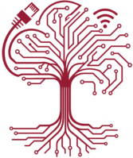
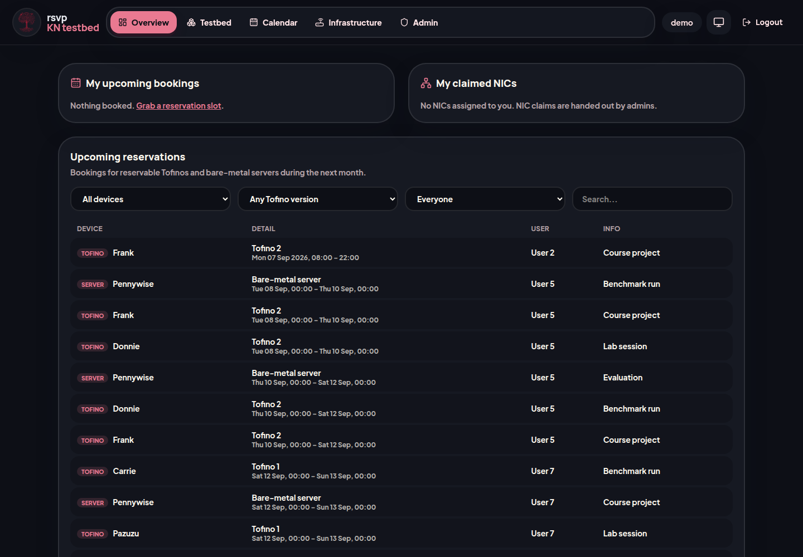
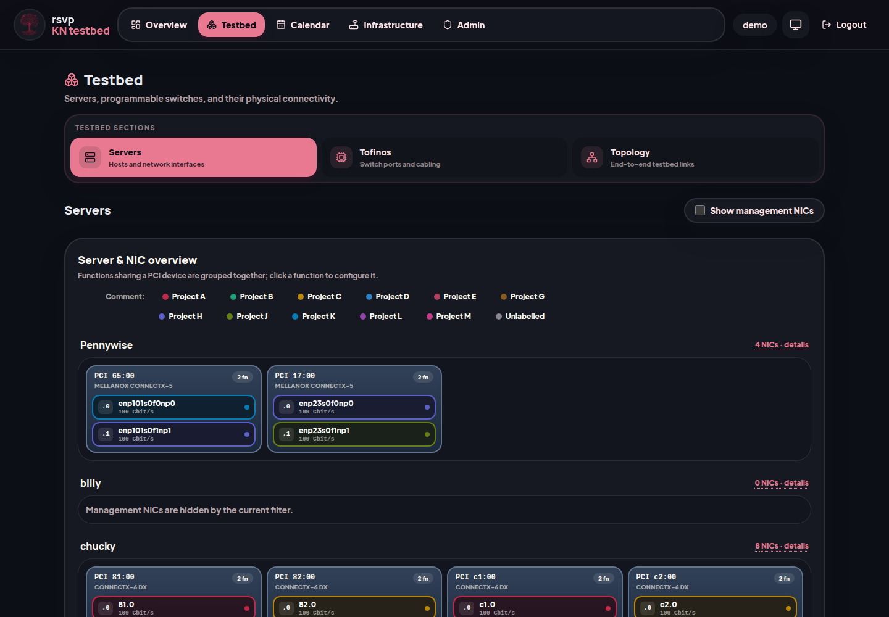
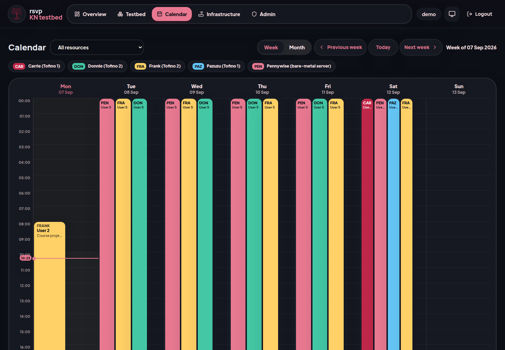
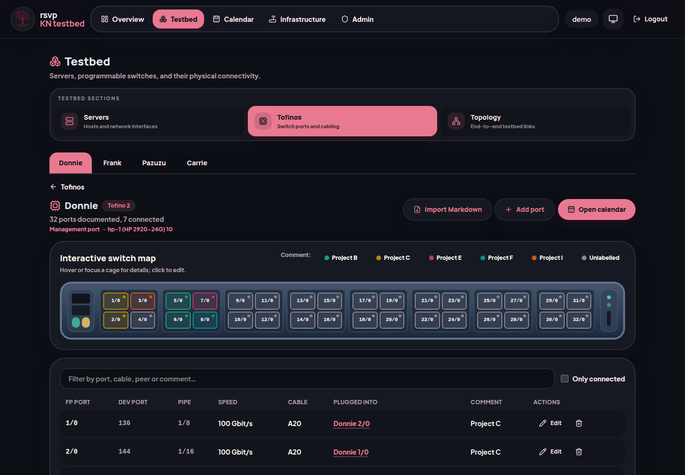
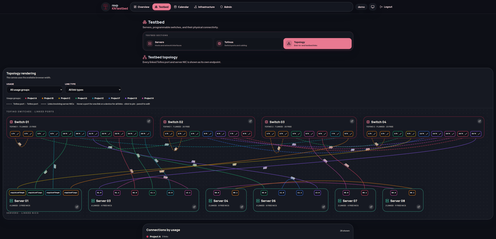

<div align="center">



# rsvp

### Reserve the hardware. See the wiring. Keep the lab moving.

[](https://github.com/n1tr0-5urf3r/kn-rsvp/actions/workflows/ci.yml)
[](LICENSE)


A self-hosted reservation and inventory console for shared networking labs.

</div>



## One place for the whole testbed

- **Reservations** — book programmable switches and bare-metal servers in responsive week or month calendars. Conflicts are rejected atomically; editing and deletion stay owner-aware.
- **Hardware inventory** — document servers, PCI functions, NUMA affinity, speeds, claims, cables, and peers. Related NIC functions are grouped into compact visual cards.
- **Switch maps** — browse and edit interactive Tofino faceplates, import Markdown port maps, and keep both ends of every cable in sync.
- **Topology** — follow the physical testbed from port to port with usage-aware colors, filters, cable labels, and per-endpoint details.
- **Infrastructure** — map management switches, VLAN membership, trunks, BMC links, and the management topology in a separate admin workspace.
- **Identity and operations** — Authentik OIDC, group-based access, admin tooling, light/dark themes, Swagger/OpenAPI, and one-way Nextcloud CalDAV sync with retry status.

<table>
  <tr>
    <td></td>
    <td></td>
  </tr>
  <tr>
    <td align="center"><strong>Server & NIC inventory</strong></td>
    <td align="center"><strong>Conflict-safe scheduling</strong></td>
  </tr>
  <tr>
    <td colspan="2"></td>
  </tr>
  <tr>
    <td colspan="2" align="center"><strong>Interactive switch maps</strong></td>
  </tr>
  <tr>
    <td colspan="2"></td>
  </tr>
  <tr>
    <td colspan="2" align="center"><strong>End-to-end topology</strong></td>
  </tr>
</table>

## Quick start

The production image contains the React frontend and Rust API; SQLite data remains on the host.

```sh
cp .env.example .env
# Configure OIDC and replace SESSION_SECRET.
docker compose up -d
curl http://localhost:4343/api/v1/health
```

The app is available at `http://localhost:4343`; API documentation lives at `/swagger-ui`. Compose always pulls `unituekn/rsvp:latest`, and data is stored in `${DATA_DIR:-./data}/rsvp.db`.

## Make it yours

All deployment-facing identity is runtime configuration, so one image can serve different labs. Set these in `.env`:

| Variable              | Default                 | Purpose                                                   |
| --------------------- | ----------------------- | --------------------------------------------------------- |
| `APP_NAME`            | `RSVP`                  | Product name shown in the header and footer               |
| `APP_SUBTITLE`        | `Hardware reservations` | Short deployment label                                    |
| `APP_TAGLINE`         | See `.env.example`      | Login-page description                                    |
| `APP_LOGO_URL`        | empty                   | Logo URL; empty uses the bundled generic mark             |
| `APP_FAVICON_URL`     | `/favicon.svg`          | Browser icon URL                                          |
| `TOPOLOGY_*`          | empty                   | Optional rack order, uplink labels/preference, and gateway |
| `CALDAV_PRODUCT_ID`   | generic RSVP ID         | iCalendar `PRODID`                                        |
| `CALDAV_UID_DOMAIN`   | `localhost`             | Domain used for new event UIDs                            |
| `PUBLIC_BASE_URL`     | `http://localhost:4343` | Public origin, OIDC callback base, and secure-cookie hint |
| `AUTH_ALLOWED_GROUPS` | `members,admins`        | Groups allowed to sign in; empty allows every OIDC user   |
| `AUTH_ADMIN_GROUPS`   | `admins`                | Groups receiving administration access                    |
| `TIMEZONE`            | `UTC`                   | Deployment timezone                                       |

To keep a private logo out of source control, place it beside the database and point the environment at the app's `/branding` route:

```sh
mkdir -p data/branding
cp /path/to/logo.png data/branding/logo.png
printf '\nAPP_LOGO_URL=/branding/logo.png\nAPP_FAVICON_URL=/branding/logo.png\n' >> .env
```

See [`.env.example`](.env.example) for networking, storage, OIDC, sessions, Docker, and calendar metadata. Never commit `.env`; production should use a long random `SESSION_SECRET` and keep `AUTH_DEV_MODE=0`.

## Authentication and calendar sync

Create an Authentik OAuth2/OpenID provider using Authorization Code flow, enable `openid profile email groups`, assign a signing key, and register:

```text
${PUBLIC_BASE_URL}/api/v1/auth/callback
```

Calendar sync is configured under **Admin → CalDAV**. Use a calendar's internal CalDAV URL, its owner's username, and a Nextcloud app password. Sync is one-way, queued, and retried with visible status; app passwords are stored in SQLite, so protect backups accordingly.

## Local development

```sh
# terminal 1 — API on :3125, using the existing data directory
AUTH_DEV_MODE=1 DATABASE_URL=sqlite://data/rsvp.db cargo run --manifest-path backend/Cargo.toml

# terminal 2 — UI on :5173, proxying API requests to :3125
cd frontend && npm ci && npm run dev
```

Development-only sign-in:

```text
http://localhost:5173/api/v1/auth/dev-login?name=alice&admin=true
```

Checks mirror CI:

```sh
cd backend && cargo fmt --check && cargo clippy --all-targets -- -D warnings && cargo test
cd frontend && npm run lint && npm run test && npm run build
docker build .
```

## Import hardware

`scripts/collect-nics.sh` reads Linux PCI/NIC facts without installing an agent. `scripts/nic_inventory.py` collects from SSH hosts and can seed the live API.

```sh
python3 scripts/nic_inventory.py collect --hosts-file scripts/hosts.txt
python3 scripts/nic_inventory.py seed nics.json --api http://localhost:4343 \
  --cookie "rsvp_session=..." --dry-run
```

Management VLANs can likewise be discovered with `scripts/vlan_inventory.py`; front-panel layouts live in `front_panel_mappings/`.

```sh
cp scripts/switches.txt.example scripts/switches.txt
python3 scripts/vlan_inventory.py collect --switches-file scripts/switches.txt
```

## CI and mirroring

GitHub Actions verifies Rust formatting, Clippy, backend tests/build, frontend lint/tests/build, and a no-push `unituekn/rsvp:latest` Docker build. GitLab builds and pushes `unituekn/rsvp:latest` plus a commit-SHA tag. GitLab remains authoritative: after a successful default-branch pipeline, `github_sync` publishes a clean snapshot commit to [GitHub](https://github.com/n1tr0-5urf3r/kn-rsvp) without exposing the private GitLab history or tags.

Configure these protected, masked GitLab CI/CD variables:

- `GITHUB_PUSH_TOKEN` — fine-grained GitHub token with **Contents: read/write** for this repository.
- `DOCKERHUB_TOKEN` — token for the `unituekn` Docker Hub account.

## License

Copyright © 2026 Fabian Ihle.

RSVP is free software licensed under the [GNU Affero General Public License v3.0 only](LICENSE) (`AGPL-3.0-only`). When you run a modified version as a network service, its users must be offered the corresponding source code under the same license.

---

<div align="center">

### Does RSVP make your lab a little easier?

If this project saves you time, you can help keep it maintained and improving.

<a href="https://www.paypal.com/donate/?hosted_button_id=KXMYX49C6MLLN">
  
</a>

</div>

Version: **1.5.0**
